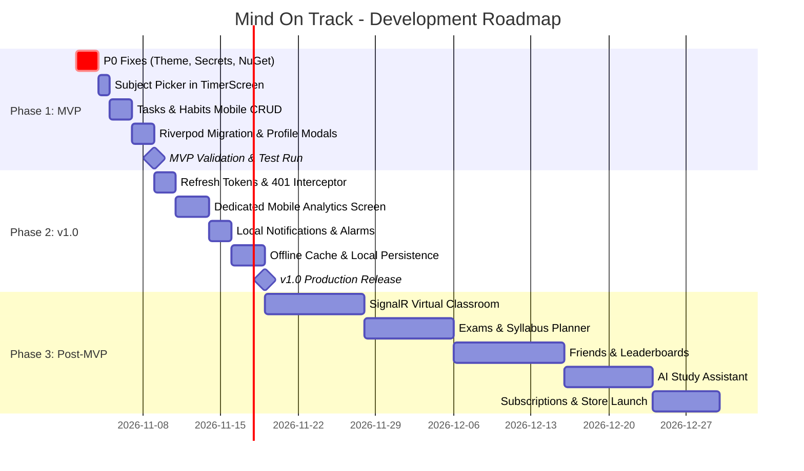

# Mind On Track (MOT) - Development Estimates & Schedule

**Audit Date:** October 31, 2026  
**Auditor:** Senior Software Architect, Technical Lead & Project Auditor  
**Resource Baseline:** 1 Senior Full-Stack Developer with AI Coding Assistance  
**Velocity Baseline:** 6 productive focused hours per workday (30 hours per 5-day workweek)  

---

## 1. Estimation Methodology & Assumptions

1. **Leveraging Existing Assets:** Calculations strictly deduct all completed backend handlers (514 passing tests) and Flutter screens. Only real remaining delta tasks are estimated.
2. **AI-Assisted Multiplier:** Leveraging AI coding tools for boilerplate, test scaffolding, and UI styling yields an estimated 1.5x–2x speedup compared to manual greenfield development.
3. **Three-Point Estimation:**
   - **Optimistic ($O$):** Ideal conditions, zero unforeseen integration blockers or third-party SDK bugs.
   - **Realistic ($R$):** Typical edge-case troubleshooting, normal debugging, review, and refactoring cycles.
   - **Conservative ($C$):** Complex environment bugs, device-specific quirks, and extended testing cycles.
   - **PERT Expected Hours:** $E = \frac{O + 4R + C}{6}$

---

## 2. Incomplete Feature Hours Estimation Table

| Feature / Module | Remaining Backend Hours | Remaining Flutter Hours | Testing Hours | Realistic Total Hours | Optimistic Total Hours | Conservative Total Hours | Realistic Days (6h/day) |
| :--- | :---: | :---: | :---: | :---: | :---: | :---: | :---: |
| **Theme & Build Fix (`CardTheme`)** | 0 | 0.5 | 0.5 | **1** | 0.5 | 2 | 0.2 |
| **Secrets Remediation & Rotation** | 1.5 | 0 | 0.5 | **2** | 1 | 3 | 0.3 |
| **NuGet Package Alignment** | 0.5 | 0 | 0.5 | **1** | 0.5 | 2 | 0.2 |
| **Subject Selection in Timer** | 0 | 3 | 1 | **4** | 2.5 | 6 | 0.7 |
| **Task Mobile CRUD (Edit/Delete)** | 0 | 3.5 | 1.5 | **5** | 3.5 | 7.5 | 0.8 |
| **Habit Mobile CRUD (Edit/Delete)** | 0 | 3.5 | 1.5 | **5** | 3.5 | 7.5 | 0.8 |
| **Tasks & Habits Riverpod Migration** | 0 | 4.5 | 1.5 | **6** | 4 | 9 | 1.0 |
| **Profile & Password Mobile Modals** | 0 | 3 | 1 | **4** | 2.5 | 6 | 0.7 |
| **Subtotal: Functional MVP Completion** | **2.0** | **18.0** | **8.0** | **28** | **18.0** | **43.0** | **4.7 Days (~1 Wk)** |
| Refresh Token Rotation & 401 Interceptor | 6 | 4 | 2 | **12** | 8 | 18 | 2.0 |
| Dedicated Mobile Analytics Screen | 0 | 10 | 4 | **14** | 9 | 20 | 2.3 |
| Local Notifications & Timer Alarms | 0 | 7 | 3 | **10** | 6 | 15 | 1.7 |
| MariaDB Automated CI Testing | 4 | 0 | 2 | **6** | 4 | 10 | 1.0 |
| Offline Cache & Session Sync Queue | 4 | 10 | 4 | **18** | 12 | 26 | 3.0 |
| **Subtotal: Version 1.0 Hardening** | **14.0** | **31.0** | **15.0** | **60** | **39.0** | **89.0** | **10.0 Days (~2 Wks)** |
| Realtime SignalR Classroom & Video | 24 | 22 | 8 | **54** | 36 | 78 | 9.0 |
| Exams & Syllabus Planner | 16 | 20 | 8 | **44** | 30 | 62 | 7.3 |
| Friends & Social Study Feed | 14 | 18 | 8 | **40** | 28 | 56 | 6.7 |
| Global & Group Leaderboards | 12 | 16 | 6 | **34** | 24 | 48 | 5.7 |
| AI Study Assistant (LLM Integration) | 18 | 22 | 8 | **48** | 32 | 68 | 8.0 |
| Document Scanner & OCR Notes | 8 | 24 | 8 | **40** | 26 | 58 | 6.7 |
| Premium In-App Subscriptions | 14 | 16 | 6 | **36** | 24 | 52 | 6.0 |
| Community Decks & Study Discussions | 16 | 20 | 8 | **44** | 30 | 62 | 7.3 |
| Admin Panel & User Moderation | 16 | 14 | 6 | **36** | 24 | 52 | 6.0 |
| **Subtotal: Advanced Planned Features** | **138.0** | **172.0** | **66.0** | **376** | **254.0** | **536.0** | **62.7 Days (~12.5 Wks)** |

---

## 3. Milestone Completion Summary

| Target Milestone | Optimistic Effort | Realistic Effort | Conservative Effort | Realistic Calendar Time | Target Deliverable |
| :--- | :---: | :---: | :---: | :---: | :--- |
| **1. Functional MVP** | 18 hrs | **28 hrs** | 43 hrs | **1.0 Week** | Fully usable core study loop without bugs or secret leaks |
| **2. Stable Version 1.0** | 57 hrs | **88 hrs** | 132 hrs | **3.0 Weeks** | MVP + Analytics screen, notifications, offline sync, refresh tokens |
| **3. Full Application Scope** | 311 hrs | **464 hrs** | 668 hrs | **15.5 Weeks** | Complete vision with AI, Realtime Classroom, Exams, and Community |

---

## 4. Week-by-Week Execution Timeline

### Week 1 — MVP Remediation & Core Feature Polish
* **Day 1 (Mon):** Fix `CardTheme` in `theme.dart`; sanitize secrets in `appsettings.json`; align EF Core 8.0.4 NuGet packages; verify 100% clean builds.
* **Day 2 (Tue):** Wire `subjectId` into `StudySessionRepository` and add subject picker in `TimerScreen`.
* **Day 3 (Wed):** Implement Task edit/delete workflows in `TaskDashboardScreen` and `task_repository.dart`.
* **Day 4 (Thu):** Implement Habit edit/delete workflows in `HabitDashboardScreen` and `habit_repository.dart`.
* **Day 5 (Fri):** Refactor Tasks/Habits to Riverpod; add Edit Profile & Change Password dialogs; execute full MVP test pass.
* **Milestone:** **MVP Ready for Internal Staging / Closed Beta Testing.**

### Week 2 — Version 1.0 Hardening (Reliability & Reports)
* **Day 6–7:** Implement refresh tokens in ASP.NET Core and Dio 401 retry interceptor in Flutter.
* **Day 8–10:** Build the dedicated mobile `AnalyticsScreen` with historical focus charts and subject distribution graphs.

### Week 3 — Version 1.0 Release (Offline & Notifications)
* **Day 11–12:** Implement local notifications for timer alarms and daily study goal reminders.
* **Day 13–14:** Implement basic local SQLite/Hive caching for offline study session queueing.
* **Day 15:** Configure MariaDB automated CI testing in GitHub Actions; complete production deployment preflight.
* **Milestone:** **Stable Version 1.0 Public Store Release.**

---

## 5. Post-MVP Feature Roadmap (Weeks 4–16)

* **Weeks 4–5 (Sprint 1): SignalR Realtime Classroom & Native Video:**  
  Replace HTTP polling with bidirectional WebSockets; embed in-app video via Agora or Jitsi SDK; implement room presence and chat.
* **Weeks 6–7 (Sprint 2): Exams & Syllabus Breakdown:**  
  Build exam entity, exam countdown widget, syllabus topic checklists, and weighted study hour planning.
* **Weeks 8–9 (Sprint 3): Social & Leaderboards:**  
  Implement friend requests, study activity feeds, weekly study leagues, and competitive leaderboards.
* **Weeks 10–11 (Sprint 4): AI Study Assistant:**  
  Integrate Gemini / OpenAI API for flashcard auto-generation, AI-driven study summaries, and intelligent session recommendations.
* **Weeks 12–13 (Sprint 5): Document Scanner & OCR:**  
  Integrate document scanning and text extraction for digitizing handwritten notes directly into study subjects.
* **Weeks 14–15 (Sprint 6): Community & Study Decks:**  
  Public community forums, shared study routines, deck sharing, and peer encouragement.
* **Week 16 (Sprint 7): Monetization & Administration:**  
  RevenueCat in-app subscription integration (Free vs Pro tiers), admin moderation dashboard, and analytics telemetry.
