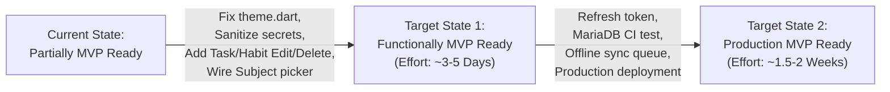

# Mind On Track (MOT) - MVP Readiness Assessment

**Audit Date:** October 31, 2026  
**Auditor:** Senior Software Architect, Technical Lead & Project Auditor  
**Product:** Mind On Track (MOT) Study Productivity Mobile Application  

---

## 1. Executive Verdict & MVP Classification

### Current Readiness Status: **PARTIALLY MVP READY**

```
[ ] Not MVP Ready
[*] Partially MVP Ready  <-- CURRENT AUDIT STATUS
[ ] Functionally MVP Ready
[ ] Production MVP Ready
```

### Assessment Summary

Mind On Track has built an exceptional, highly cohesive core foundation. Its backend Clean Architecture, CQRS/MediatR pipeline, multi-tenant isolation, data integrity constraints, and gamified study loop are extraordinarily solid. 

However, the application is classified as **Partially MVP Ready** (rather than *Functionally MVP Ready* or *Production MVP Ready*) due to **three primary gating deficiencies**:
1. **Critical Flutter Compilation Bug:** A theme incompatibility (`CardTheme` vs `CardThemeData`) in `frontend/lib/core/theme.dart` prevents test compilation on standard Flutter 3.24+ / 3.47+ toolchains.
2. **Critical Security Secret Leak:** Version-controlled production connection strings and JWT secrets in `appsettings.json`.
3. **Incomplete Mobile CRUD & Subject Integration:** The user cannot edit/delete tasks or habits in the Flutter UI, cannot edit their display name in the profile UI, and cannot select a subject when starting a study session.

Once these specific items are resolved (estimated at 24–35 developer hours), the application will immediately ascend to **Production MVP Ready**.

---

## 2. Core MVP Capability Evaluation Matrix

| Core MVP Capability | Backend Status | Mobile UI Status | Verification | Deficiencies / Gaps |
| :--- | :---: | :---: | :---: | :--- |
| **1. Registration and Login** | **COMPLETE** | **COMPLETE** | Verified | PBKDF2 hashing, JWT issuance, email OTP password reset dialog. Needs refresh token rotation. |
| **2. User Profile** | **COMPLETE** | **PARTIAL** | Verified | Displays real stats, level, XP, and streaks. Missing UI dialog to edit display name or change password. |
| **3. Subjects** | **COMPLETE** | **COMPLETE** | Verified | Full CRUD in backend and mobile UI with custom color tags and case-insensitive uniqueness per user. |
| **4. Study Timer** | **COMPLETE** | **COMPLETE** | Verified | Reactive Start/Pause/Resume/End with app lifecycle synchronization and action loading guards. |
| **5. Start/Pause/Resume/End Study Session** | **COMPLETE** | **COMPLETE** | Verified | Filtered unique database index enforces single active session; accumulated seconds exclude pauses. |
| **6. Session History** | **COMPLETE** | **PARTIAL** | Verified | Dashboard displays top 5 recent sessions. Full paginated historical list view screen is not implemented. |
| **7. Daily Goals** | **COMPLETE** | **COMPLETE** | Verified | Date navigation, circular progress ring, preset duration chips, UTC timezone conversion. |
| **8. Dashboard** | **COMPLETE** | **COMPLETE** | Verified | Unified composite aggregate query (`/api/dashboard`), active session banner, weekly chart, auto-refresh. |
| **9. Basic Statistics** | **COMPLETE** | **COMPLETE** | Verified | 7-day rolling focus minutes chart on dashboard, level progress, total focus hours on profile. |
| **10. Streaks** | **COMPLETE** | **COMPLETE** | Verified | Deterministic habit streak engine with gap detection, header flame badges, and milestone achievements. |

---

## 3. Gap Analysis to Reach Subsequent Readiness Levels



### Gap 1: What is missing to reach "Functionally MVP Ready"?
*Estimated Effort: 24 to 32 Development Hours (3 to 5 Days)*

1. **Fix `theme.dart` Compatibility (`CRIT-02`):**  
   Change `CardTheme(...)` to `CardThemeData(...)` in `lib/core/theme.dart:47` so all Flutter tests and production builds compile cleanly.
2. **Wire Subject Picker in `TimerScreen` (`MED-05`):**  
   Expose `SubjectId` in `StudySessionRepository.startSession()` and add a dropdown or chip picker in `TimerScreen` so users can categorize study sessions.
3. **Complete Tasks & Habits Mobile Workflows (`MED-04`):**  
   Add delete and edit dialogs/bottom sheets in `TaskDashboardScreen` and `HabitDashboardScreen`, hooking into the existing backend `PUT` and `DELETE` endpoints.
4. **Complete Profile & Settings Actions (`MED-04`):**  
   Add an "Edit Display Name" dialog in `ProfileScreen` calling `PUT /api/auth/profile` and a "Change Password" dialog in `SettingsScreen` calling `POST /api/auth/change-password`.

---

### Gap 2: What is missing to reach "Production MVP Ready"?
*Estimated Effort: 45 to 65 Development Hours (1.5 to 2 Weeks)*

1. **Security & Secrets Remediation (`CRIT-01`):**  
   Rotate database passwords and JWT secrets; scrub all hardcoded credentials from `appsettings.json`; enforce environment variable injection in the cloud deployment environment.
2. **Session Resilience & Token Auto-Refresh (`HIGH-01`):**  
   Implement refresh tokens and a Dio 401 interceptor so users do not get abruptly logged out during study sessions.
3. **Automated MariaDB Integration Testing (`MED-03`):**  
   Enable GitHub Actions integration test runner against a live MariaDB container to ensure raw database constraints and migrations behave identically to the development mocks.
4. **Decouple Database Migrations from Runtime Boot (`MED-02`):**  
   Remove `dbContext.Database.Migrate()` from `Program.cs` and replace with a dedicated pre-deployment migration script to avoid multi-instance deployment locks.
5. **Basic Offline Timer Resilience (`HIGH-04`):**  
   Ensure active timer state is stored in local storage so that if the user closes the app or loses internet while studying, the session duration is not lost.

---

## 4. Final Recommendation on MVP Launch

**Do NOT launch to production in the current state.**

The team should execute a focused **1-week sprint (P0 & P1 backlog)** to resolve the 3 functional blockers and 2 security/build blockers identified above. Following that sprint, Mind On Track will be fully functional, reliable, secure, and ready for public beta launch.
