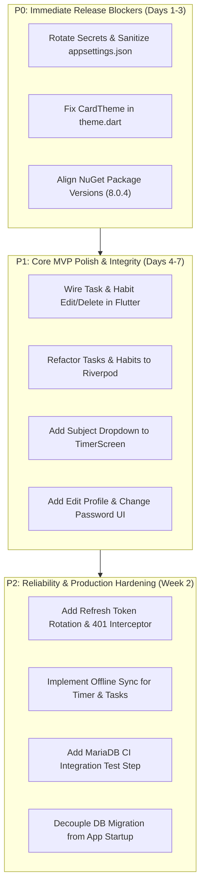

# Mind On Track (MOT) - Technical Debt & Health Audit Report

**Audit Date:** October 31, 2026  
**Auditor:** Senior Software Architect, Technical Lead & Project Auditor  
**Project:** Mind On Track (MOT) Study Productivity Application  
**Target Environments:** Mobile (Flutter / Dart) & Backend (ASP.NET Core 8 / MariaDB)

---

## 1. Executive Summary

This Technical Health Audit provides an exhaustive assessment of architectural integrity, security posture, database reliability, performance bottlenecks, and code debt across the Mind On Track codebase. 

While the core Clean Architecture and MediatR CQRS pattern in the backend are exceptionally well-engineered with strict tenant isolation, comprehensive validation, and 514 passing unit tests, several **Critical and High-severity issues** were identified that must be addressed prior to any public or production release.

---

## 2. Issue Severity Classification Summary

| Severity | Confirmed Issues | Potential Risks | Total Issues |
| :--- | :---: | :---: | :---: |
| **Critical** | 2 | 1 | 3 |
| **High** | 3 | 2 | 5 |
| **Medium** | 5 | 3 | 8 |
| **Low** | 4 | 2 | 6 |
| **Total** | **14** | **8** | **22** |

---

## 3. Detailed Technical Health Findings

### Category A: Security & Secrets Management

#### [CRIT-01] Hardcoded Production Credentials in Version Control (`appsettings.json`)
* **Status:** Confirmed Issue
* **Severity:** **CRITICAL**
* **Location:** `backend/MOT.Api/appsettings.json` (Lines 10, 13, 22)
* **Details:** 
  The version-controlled `appsettings.json` file contains active plaintext production connection strings for an external MariaDB host (`mysql.gb.stackcp.com`), an active production JWT Secret key (`SuperSecretKeyForMindOnTrackMVP123!@#`), and live SMTP credentials (`smtp.stackmail.com` with plaintext password).
* **Impact:** 
  Anyone with read access to the Git repository or build artifacts has full administrative access to the database (read/write/delete), can mint valid arbitrary user JWT tokens bypassing all authentication, and can hijack the SMTP server to send phishing emails.
* **Remediation:**
  1. Immediately rotate the database password, JWT secret, and SMTP password.
  2. Sanitize `appsettings.json` to contain empty strings or development-only localhost placeholders.
  3. Enforce the use of environment variables (`DB_CONNECTION_STRING`, `JWT_SECRET`, `SMTP_PASSWORD`) in staging and production (e.g., Render Environment Variables, Docker secrets, or Azure Key Vault).
  4. Implement pre-commit hooks (such as `gitleaks` or `git-secrets`) to prevent credentials from being committed in the future.

#### [HIGH-01] Lack of Refresh Token Rotation & Session Invalidation
* **Status:** Confirmed Issue
* **Severity:** **HIGH**
* **Location:** `backend/MOT.Api/Controllers/AuthController.cs`, `MOT.Infrastructure/Authentication/JwtProvider.cs`, `frontend/lib/core/network_client.dart`
* **Details:**
  Authentication relies strictly on a single JWT access token. There is no refresh token entity, database table, or token rotation mechanism. Furthermore, `NetworkClient` has no 401 response interceptor to handle token expiration or trigger automatic re-authentication.
* **Impact:**
  When a JWT expires, all subsequent network calls fail immediately with 401 Unauthorized, degrading the user experience. Conversely, if a token is stolen or a user's password is changed/reset, previously issued tokens cannot be revoked before their natural expiration.
* **Remediation:**
  1. Implement a `RefreshToken` entity in `MOT.Domain` with `Token`, `UserId`, `ExpiresAt`, `RevokedAt`, and cryptographic hashing.
  2. Issue short-lived access tokens (15-60 minutes) alongside longer-lived refresh tokens (7-30 days) stored securely in `flutter_secure_storage`.
  3. Add a Dio interceptor in `NetworkClient` to automatically catch 401 errors, invoke the refresh endpoint, update the stored token, and replay failed requests seamlessly.

---

### Category B: Compilation, SDK & Build Health

#### [CRIT-02] Flutter SDK Compilation Failure: `CardTheme` vs `CardThemeData` Incompatibility
* **Status:** Confirmed Issue
* **Severity:** **CRITICAL** (Blocks Flutter build & widget tests)
* **Location:** `frontend/lib/core/theme.dart:47:18`
* **Details:**
  Commit `7b2a883` attempted to provide backward compatibility for Flutter 3.19 by replacing `cardTheme: const CardThemeData(...)` with `cardTheme: CardTheme(...)`. In modern Flutter versions (including the installed Flutter 3.47.1 / Dart 3.13), `ThemeData.cardTheme` strictly requires `CardThemeData?`. As a result, static analysis emits an error and 2 test suites fail to compile:
  - `frontend/test/dashboard_screen_test.dart`
  - `frontend/test/gamification_ui_and_provider_test.dart`
* **Impact:**
  Mobile builds fail or cannot execute automated widget test suites on newer Flutter versions, halting CI/CD and release packaging.
* **Remediation:**
  Update `frontend/lib/core/theme.dart` line 47 to use `CardThemeData` instead of `CardTheme`:
  ```dart
  cardTheme: CardThemeData(
    color: Colors.white.withOpacity(0.08),
    elevation: 0,
    shape: RoundedRectangleBorder(...),
  ),
  ```

#### [MED-01] NuGet Package Reference Version Conflicts (MSB3277)
* **Status:** Confirmed Issue
* **Severity:** **MEDIUM**
* **Location:** `backend/MOT.Tests/MOT.Tests.csproj`, `backend/MOT.IntegrationTests/MOT.IntegrationTests.csproj`
* **Details:**
  Compiler warning `MSB3277` is emitted during test builds:
  `Found conflicts between different versions of "Microsoft.EntityFrameworkCore.Relational" that could not be resolved.`
  `Pomelo.EntityFrameworkCore.MySql 8.0.2` brings in EF Core Relational 8.0.2, whereas test project files explicitly reference `Microsoft.EntityFrameworkCore.Relational 8.0.4`.
* **Impact:**
  Build warnings clutter CI logs; potential risk of runtime assembly binding redirection issues or unexpected method signature mismatches in edge cases.
* **Remediation:**
  Align all EF Core package versions across all projects (`MOT.Infrastructure`, `MOT.Api`, `MOT.Tests`, `MOT.IntegrationTests`) to consistent version `8.0.4` or the latest compatible patch version.

#### [LOW-01] Flutter Analyzer Deprecation Infos (`withOpacity` vs `.withValues()`)
* **Status:** Confirmed Issue
* **Severity:** **LOW**
* **Location:** Across 12 Flutter UI files (81 analyzer diagnostics)
* **Details:**
  `Color.withOpacity()` is deprecated in newer Flutter versions in favor of `.withValues(alpha: ...)`. There are also 2 occurrences of `use_build_context_synchronously` warnings in `subjects_screen.dart` and `daily_goals_screen.dart`.
* **Impact:**
  Technical clutter in analysis; potential future deprecation removal in future major Flutter SDK releases.
* **Remediation:**
  Refactor deprecated `withOpacity(x)` calls to `.withValues(alpha: x)` once the project standardizes on Flutter 3.27+.

---

### Category C: Architecture & State Management

#### [HIGH-02] Architectural Inconsistency: Mixed State Management Patterns
* **Status:** Confirmed Issue
* **Severity:** **HIGH**
* **Location:** 
  - `frontend/lib/features/tasks/presentation/screens/task_dashboard_screen.dart`
  - `frontend/lib/features/habits/presentation/screens/habit_dashboard_screen.dart`
* **Details:**
  While `Dashboard`, `Profile`, `Subjects`, `DailyGoals`, and `Gamification` adhere to reactive Riverpod providers (`FutureProvider`, `ProviderScope`), the `Tasks` and `Habits` dashboards instantiate `TaskRepository(NetworkClient())` and `HabitRepository(NetworkClient())` directly inside raw `StatefulWidget` classes (`_loadTasks()`, `_loadHabits()`).
* **Impact:**
  1. Bypasses Riverpod lifecycle and global error caching.
  2. Prevents reactive cache invalidation when tasks or habits are toggled from other screens (e.g. Dashboard cards).
  3. Creates redundant `NetworkClient` and `Dio` instances per screen.
* **Remediation:**
  Refactor `TaskDashboardScreen` and `HabitDashboardScreen` to `ConsumerStatefulWidget` / `ConsumerWidget`, creating `tasksProvider` and `habitsProvider` (`AsyncNotifierProvider` or `FutureProvider`).

#### [HIGH-03] Virtual Classroom Realtime Architecture Bottleneck (HTTP Polling vs SignalR)
* **Status:** Confirmed Issue
* **Severity:** **HIGH**
* **Location:** 
  - `backend/MOT.Api/Controllers/ClassroomsController.cs`
  - `frontend/lib/features/classroom/presentation/screens/virtual_classroom_screen.dart`
* **Details:**
  The Virtual Classroom relies on client-side HTTP polling every 10 seconds (`GET classrooms/{roomName}/participants`) and periodic ping requests every 20 seconds (`POST classrooms/{roomName}/ping`). Room presence is tracked in a database table with a 60-second cutoff. Video is delegated to an external browser launch of `meet.jit.si`.
* **Impact:**
  1. Severe latency (up to 10 seconds delay to detect a user entering or leaving a room).
  2. High database read/write thrashing under concurrent users (constant polling and ping updates).
  3. Poor user experience when switching apps to third-party Jitsi browser tabs instead of embedded mobile video.
* **Remediation:**
  1. Introduce ASP.NET Core SignalR (`ClassroomHub`) with WebSockets for instantaneous presence broadcast and seat locking.
  2. Embed Jitsi or Agora SDK directly into Flutter for an in-app native video experience.

---

### Category D: Database & Persistence Risks

#### [MED-02] Automatic Production Migration on Application Boot (`dbContext.Database.Migrate()`)
* **Status:** Confirmed Issue
* **Severity:** **MEDIUM**
* **Location:** `backend/MOT.Api/Program.cs` (Lines 117–121)
* **Details:**
  `app.Services.CreateScope().ServiceProvider.GetRequiredService<AppDbContext>().Database.Migrate();` executes automatically on every backend startup.
* **Impact:**
  1. In multi-instance or auto-scaling environments (e.g. Render / Kubernetes), concurrent container startups will attempt to apply migrations simultaneously, causing database table locks or race conditions.
  2. If a migration fails or is incompatible, the entire application fails to boot, causing severe deployment downtime.
* **Remediation:**
  Decouple database migration from runtime application startup. Apply migrations via a dedicated CI/CD release step (e.g., `dotnet ef database update` in GitHub Actions or an entrypoint migration job) or wrap `Migrate()` with an environment check allowing auto-migration only in Development/Staging.

#### [MED-03] Lack of Real Database Integration Testing in CI
* **Status:** Potential Risk
* **Severity:** **MEDIUM**
* **Location:** `backend/MOT.Tests/Common/MockDbSetHelper.cs`
* **Details:**
  All 514 backend unit tests execute against in-memory mock LINQ collections (`MockDbSetHelper`). `MOT.IntegrationTests` contains test scaffolding for MariaDB, but is guarded and skipped in CI (`MOT_ENABLE_MYSQL_INTEGRATION_TESTS` not enabled).
* **Impact:**
  MySQL-specific behavior, collation rules, foreign key constraints (`ON DELETE SET NULL`, `ON DELETE CASCADE`), and MariaDB 10.11 SQL dialect quirks cannot be verified without executing against a real MySQL/MariaDB container.
* **Remediation:**
  Add a GitHub Actions job with a `mariadb:10.11` service container to execute `MOT.IntegrationTests` on every pull request.

---

### Category E: Missing Functionality & User Experience Gaps

#### [MED-04] Incomplete CRUD Workflows in Mobile UI
* **Status:** Confirmed Issue
* **Severity:** **MEDIUM**
* **Location:** `frontend/lib/features/tasks/`, `frontend/lib/features/habits/`, `frontend/lib/features/profile/`
* **Details:**
  The backend provides complete CRUD endpoints, but the Flutter UI has partial implementations:
  1. **Tasks:** Backend supports `PUT /api/tasks/{id}` and `DELETE /api/tasks/{id}`, but the Flutter UI only provides creation and toggle. Users cannot edit or delete tasks.
  2. **Habits:** Backend supports `PUT /api/habits/{id}` and `DELETE /api/habits/{id}`, but the Flutter UI only provides creation and toggle. Users cannot edit or delete habits.
  3. **Profile:** Backend supports `PUT /api/auth/profile` and `POST /api/auth/change-password`, but the Profile screen has no UI trigger or modal for updating the display name or changing password.
* **Impact:**
  Users are trapped with typos or unwanted habits/tasks and cannot maintain their profile without contacting support.
* **Remediation:**
  Add swipe-to-delete / edit action dialogs in `TaskDashboardScreen` and `HabitDashboardScreen`, and add an "Edit Profile" and "Change Password" modal in `ProfileScreen` and `SettingsScreen`.

#### [MED-05] Subject Selection Disconnected from Study Timer Startup
* **Status:** Confirmed Issue
* **Severity:** **MEDIUM**
* **Location:** 
  - `frontend/lib/features/timer/presentation/screens/timer_screen.dart`
  - `frontend/lib/features/timer/data/repositories/study_session_repository.dart`
* **Details:**
  The database entity `StudySession` and backend command `StartStudySessionCommand` support linking sessions to a `SubjectId`. However, Flutter `StudySessionRepository.startSession(String title)` only accepts a title string and does not expose `subjectId`. `TimerScreen` lacks a subject selector dropdown.
* **Impact:**
  All study sessions recorded from mobile have `SubjectId = null`, preventing users from tracking subject-specific focus time metrics.
* **Remediation:**
  Add `subjectId` parameter to `startSession()`, fetch user subjects via `subjectsProvider`, and add an intuitive subject chip/picker in `TimerScreen` before starting the session.

#### [LOW-02] Dedicated Focus Analytics Screen Missing in Mobile App
* **Status:** Confirmed Issue
* **Severity:** **LOW**
* **Location:** `frontend/lib/features/analytics/`
* **Details:**
  Backend has complete analytics queries (`GET /api/analytics/summary`, `GET /api/analytics/daily`, `GET /api/analytics/weekly`). Flutter has models and `AnalyticsRepository`, but no screen exists. Users can only view a brief 7-day bar chart on the Dashboard.
* **Impact:**
  Users cannot view their historical study trends, subject breakdowns, or productivity distributions.
* **Remediation:**
  Develop `AnalyticsScreen` with monthly/weekly focus time charts, subject time allocation pie charts, and task completion velocity.

---

### Category F: Reliability & Offline Handling

#### [HIGH-04] Zero Offline Data Persistence / Caching
* **Status:** Potential Risk
* **Severity:** **HIGH**
* **Location:** `frontend/lib/core/network_client.dart`
* **Details:**
  The mobile app has no local SQLite / Hive / Isar database. Only JWT tokens and onboarding flags are stored in `SharedPreferences`.
* **Impact:**
  When network connectivity drops (e.g. studying in a library or offline basement):
  1. The app displays raw network errors.
  2. Study sessions cannot be safely saved locally and synchronized later.
  3. Dashboard, Tasks, and Habits cannot be viewed in offline mode.
* **Remediation:**
  Integrate a local caching layer (such as `drift` or `hive`) with an offline sync queue that captures completed study sessions and syncs them automatically when connectivity resumes.

---

## 4. Prioritized Action Plan


